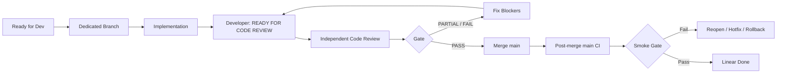

# Engineering Management Operating Model

## Purpose

Define how approved product work is implemented, independently reviewed, merged and verified without allowing a developer to self-certify correctness.

## Standard lifecycle

## Core rules

1. Prefer one Linear issue per PR.
2. Keep PR scope clean; do not silently carry unrelated issue commits.
3. Developer status is `READY FOR CODE REVIEW`, not `validated` or `mergeable`.
4. Evidence beats assertion: tests, diff, CI, sample validation and exact SHA are required.
5. Missing/unverified data returns explicit N/A/error; never fabricate.
6. V4 production behavior stays protected until V5 passes its release gate.
7. A PR may merge only after independent Gate PASS.
8. After merge, verify the exact merge SHA on `main` and run/inspect post-merge CI.

## Review dimensions

- Correctness and fail-closed behavior
- Point-in-time / no-look-ahead semantics
- Data contracts and provenance
- Decision quality and false-positive/recall trade-offs
- Cross-runtime parity where applicable
- V4 regression protection
- Scope cleanliness and rollback traceability
- Deterministic regression coverage

## Merge authorization

When independent Code Review + QA Gate reaches PASS, the reviewer may merge directly under the standing Product Owner authorization. PARTIAL or FAILED reviews must not merge.
