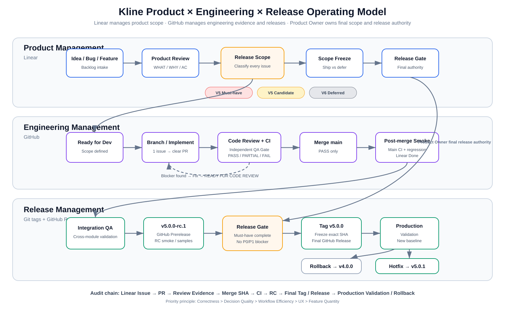
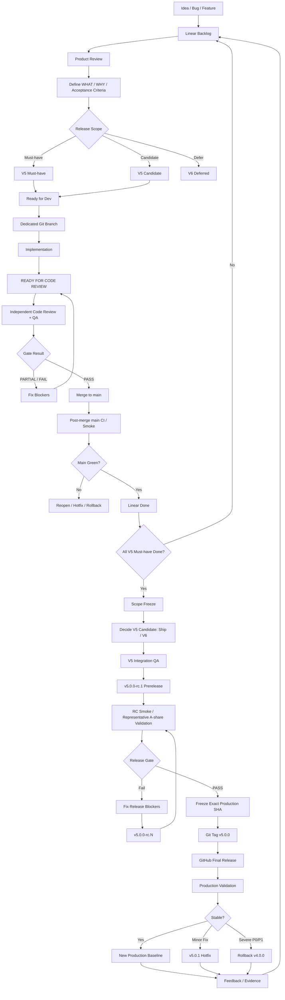
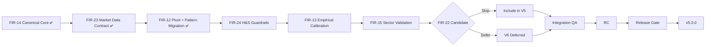

# End-to-End Product × Engineering × Release Operating Model

## Visual overview

The SVG above is the durable GitHub-native version of the interactive Visualize flow created during governance design. It is intended for quick orientation; the Mermaid diagrams below remain the editable structural source.

## System ownership

- **Linear** — Product scope, backlog, priorities, acceptance criteria, milestones and V5/V6 classification.
- **GitHub** — Branches, implementation, PR review, CI, merge history, release candidates, tags and releases.
- **Product Owner** — Final scope, deferral and release authority.
- **Independent AI Review Gate** — Code Review / QA / merge gate.

## End-to-end flow

## Decision boundaries

### Product Gate
Work cannot become `Ready for Dev` until the problem, value, acceptance criteria, dependencies, priority and release scope are sufficiently defined.

### Code / QA Gate
Developer completion is not certification. Merge requires independent review evidence and PASS.

### Main Smoke Gate
A green PR is not enough. The exact merge commit on `main` must remain green.

### Release Gate
`v5.0.0` is allowed only when scope, correctness, decision quality, integration QA, release-candidate validation and rollback readiness are all proven.

## Current V5 path

## Governance principle

Every important product decision should be traceable from:

`Linear Issue → PR → Review Evidence → Merge SHA → CI → Release Candidate → Final Tag / Release → Production Validation / Rollback`.

This traceability is the project's audit chain and is more important than feature count.
