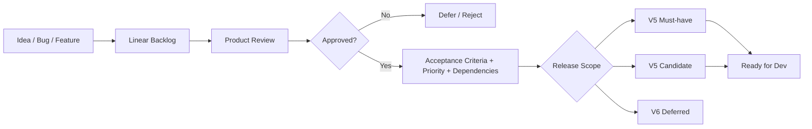

# Product Management Operating Model

## Purpose

Define how ideas, bugs, features and technical-debt items become approved product work and how they are assigned to a release scope.

## Authority

- **Founder / Product Owner**: final authority on WHAT / WHY, priority, release scope and deferral.
- **AI Product / Architecture / QA Review**: independent analysis of correctness, decision quality, acceptance criteria and release risk.
- **Developer AI**: implementation owner; may propose solutions but does not self-certify completion.

## Lifecycle

## Release-scope classes

### V5 Must-have
Release blocker for `v5.0.0`. A Must-have may move to V6 only with explicit Product Owner approval and a recorded reason/risk/alternative.

### V5 Candidate
Targeted for V5 when practical, but may be deferred at Scope Freeze if it does not affect correctness, data integrity or core decision quality.

### V6 Deferred
Explicitly outside the V5 release boundary. Does not block V5 unless re-promoted by Product Review.

## Priority model

`Correctness > Decision Quality > Workflow Efficiency > UX > Feature Quantity`

- **P0 Correctness** — data integrity, look-ahead bias, semantic mismatch, security or logic that can make the output wrong.
- **P1 Decision Quality** — signal quality, calibration, structural quality and decision-usefulness.
- **P2 Workflow Efficiency** — reduce manual work and improve repeatability.
- **P3 UX** — usability/presentation improvements.
- **P4 Nice-to-have** — convenience or optional polish.

## Scope Freeze

After V5 Scope Freeze, new feature work does not enter V5 unless it is:

- a P0 Correctness issue;
- a release-blocking regression; or
- a security/data-integrity blocker.

Everything else goes to V6 backlog by default.
