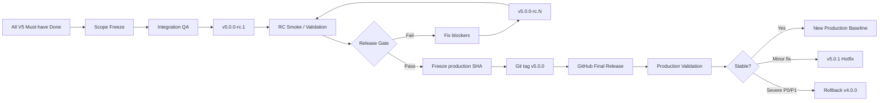

# Release Management Operating Model

## Purpose

GitHub owns the engineering execution of a product release: exact commit baseline, release candidate, QA evidence, tag, GitHub Release and rollback target.

Linear remains the source of truth for product scope; GitHub is the source of truth for what code actually shipped.

## Version lifecycle

## Release objects

### Release Candidate
Use prerelease tags such as `v5.0.0-rc.1`. RC exists for integration QA, representative A-share validation, regression checks and release-gate evidence.

### Final Production Release
`v5.0.0` is created only after Release Gate PASS. The release record must identify:

- exact production commit SHA;
- QA/Gate status;
- included scope / major issues;
- known limitations;
- rollback target;
- production validation result.

### Hotfix
Small production corrections use patch versions such as `v5.0.1` and must preserve release evidence and regression coverage.

### Rollback
Until V5 stability is confirmed, emergency rollback target remains the previously QA-PASS production baseline `v4.0.0`.

## V5 Release Gate

V5.0 cannot release unless:

- all V5 Must-have issues are Done;
- no open P0 correctness blocker exists;
- no unresolved look-ahead bias exists in pattern/calibration paths;
- Canonical Market Data Contract is enforced end-to-end;
- cross-runtime parity is green;
- V4 regression suite is green;
- V5 integration suite is green;
- empirical calibration evidence includes sample sizes/denominators;
- sector membership provenance is verified;
- RC smoke validation passes on representative A-share symbols;
- rollback to `v4.0.0` is verified.

## Release evidence

For every production release, retain:

1. Git tag and release page.
2. Exact SHA.
3. CI / Release Gate evidence.
4. Release notes / changelog.
5. Known limitations.
6. Rollback baseline.
7. Production validation result.

This evidence is the audit trail for deciding whether a release can be trusted or safely reverted.
